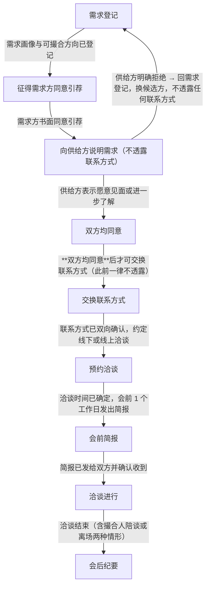

# 商机撮合 SOP：引荐、陪谈与对接话术（全部虚构）

> 岗位、企业、姓名、时间与条款均为**虚构**，仅用于流程说明与开发对照。
> 机器可读步骤见 `match_steps.json`；话术 6 条见 `match_scripts.csv`；
> 会前简报模板见 `pre_brief_template.md`；引荐流程图见 `referral_flow.md`。

## 一、一条铁律（贯穿全流程）

> **在双方都明确同意之前，不向任一方透露对方的任何联系方式**——
> 手机号、微信、邮箱、企业全称一律不给。
> 需求方只看到候选方的「画像 + 匹配理由」，供给方只看到需求方的「需求画像」。
> 该规则在 S03（向供给方说明需求）与 S06（会前简报双版本）两处分别落成检查项，
> 并在流程图里作为 N4→N5 的**唯一前置条件**（不满足不得交换联系方式）。

## 二、时限口径（三种，不混用）

| 口径 | 含义 | 本单用在哪 |
| --- | --- | --- |
| `work` | 只在工作日 09:00–18:00 内消耗时限，跨夜与周末顺延 | S01~S07、S10 |
| `natural` | 自然小时连续累加 | S08（会后 24 小时内） |
| `workdays` | **工作日数**，含当日为第 1 个工作日，保持同一时刻 | S09（3 个工作日内首次联系） |

> 三者不能互相替代：`work` 数的是小时，`natural` 数的是自然小时，`workdays` 数的是**天**。
> 每步在 `match_expected.csv` 的 `tmode` 列写明口径，`expected_due` 给出推算结果。

## 三、引荐对接流程图

关键约束：`N4 双方均同意` 是 `N5 交换联系方式` 的**唯一入口**，
图中不存在从 N1~N3 直达 N5 的边（verify 会断言这一点）。

## 四、会前简报模板（两版）

| 字段 | 名称 | 内容要求 | 备注 |
| --- | --- | --- | --- |
| brief_version | 简报版本 | 需求方版 / 供给方版 | 同一洽谈必须两版齐发 |
| demand_profile | 需求画像 | 行业/规模区间/核心诉求/时间窗 | 仅需求方版填全；供给方版只写画像摘要 |
| candidate_profile | 候选方画像 | 能力标签/可交付范围/匹配理由 | 仅供给方版填全；需求方版只写画像摘要 |
| match_reason | 匹配理由 | 3 条以内，须可验证 | 不能写「感觉合适」 |
| agenda | 建议议题 | 3~5 条 | 两版各自不同 |
| contact_policy | 联系方式口径 | 「双方同意前不透露」 | 两版都要写明 |
| owner | 本次负责人 | 招商顾问姓名（虚构） | 同一洽谈唯一负责人 |

> 需求方版与供给方版**必须分开出**：需求方版填候选方画像与可交付能力，
> 供给方版填需求画像与关注点；两版都只写「画像」，不写对方身份与联系方式。

## 五、陪谈 / 引荐后离场的判断标准

| 情形 | 判断 | 依据 |
| --- | --- | --- |
| 双方愿意当场讨论商务条款（报价口径、合作方式） | **陪谈** | 需要撮合人现场澄清范围与口径 |
| 双方直接进入技术或业务细节的对口沟通 | **引荐后离场** | 撮合人已无增量信息，留在场反而压慢沟通 |
| 一方提出超出撮合范围的要求（如要求对方提供底价） | **陪谈并当场拦截** | 越过边界的要求须由撮合人明确回绝 |
| 任一方明确表示希望单独沟通 | **引荐后离场** | 尊重当事人意愿，离场后改为会后跟进 |

> 离场情形下，撮合人仍须在 S08 时限内完成纪要，并约定后续跟进人与时间点。

## 六、首次联系时限与超时升级

| 环节 | 时限 | 口径 | 超时动作 |
| --- | --- | --- | --- |
| S09 首次联系 | **3 个工作日**（含当日为第 1 个工作日） | `workdays` | 到期未完成 → 触发 S10 |
| S10 一级升级 | 8 个工作小时内 | `work` | 招商主管介入，记录原因与补救动作 |
| S10 二级升级 | 再 8 个工作小时内 | `work` | 连续两次超时 → 升运营总监 |

> 以「周三 10:00 取得双方同意」为例：3 个工作日 → **周五 10:00**；
> 以「周五 10:00 取得同意」为例：周末不计 → **下周二 10:00**。

## 七、责任矩阵

| 步骤 | 名称 | 招商顾问 | 招商主管 | 运营总监 |
| --- | --- | --- | --- | --- |
| S01 | 需求登记与画像 | R |  |  |
| S02 | 征得需求方同意引荐 | R |  |  |
| S03 | 向供给方说明需求（不透露联系方式） | R | C |  |
| S04 | 双方同意后交换联系方式 | R |  |  |
| S05 | 预约洽谈（线下或线上） | R |  |  |
| S06 | 会前简报 | R | C |  |
| S07 | 洽谈进行与陪谈/离场判断 | R |  |  |
| S08 | 会后 24 小时内记录纪要与下一步 | R | C |  |
| S09 | 3 个工作日内完成首次联系 | R | C |  |
| S10 | 首次联系超时的升级 |  | R | C |

R = 负责（该步执行岗位）；C = 协作。

## 八、撮合需求访谈提纲（9 问）

1. 本次希望撮合的核心诉求是什么？（一句话）
2. 期望对方具备哪些能力或资源？
3. 对合作规模或投入量级有区间要求吗？
4. 希望什么时间窗内达成初步意向？
5. 此前是否尝试过类似合作？结果如何？
6. 决策人是谁？决策链大概几步？
7. 可披露给对方的信息范围到哪里？（用于确定简报内容）
8. 是否接受线下到访洽谈？还是仅接受线上？
9. 对我们的撮合有什么顾虑？

## 九、步骤时限一览

| 步骤 | 名称 | 负责岗位 | 口径 | 时限 | 推算截止 |
| --- | --- | --- | --- | --- | --- |
| S01 | 需求登记与画像 | 招商顾问 | work | 4 小时 | 2026-05-06 14:00 |
| S02 | 征得需求方同意引荐 | 招商顾问 | work | 8 小时 | 2026-05-06 18:00 |
| S03 | 向供给方说明需求（不透露联系方式） | 招商顾问 | work | 8 小时 | 2026-05-06 18:00 |
| S04 | 双方同意后交换联系方式 | 招商顾问 | work | 4 小时 | 2026-05-06 14:00 |
| S05 | 预约洽谈（线下或线上） | 招商顾问 | work | 8 小时 | 2026-05-06 18:00 |
| S06 | 会前简报 | 招商顾问 | work | 8 小时 | 2026-05-06 18:00 |
| S07 | 洽谈进行与陪谈/离场判断 | 招商顾问 | work | 2 小时 | 2026-05-06 12:00 |
| S08 | 会后 24 小时内记录纪要与下一步 | 招商顾问 | natural | 24 小时 | 2026-05-07 10:00 |
| S09 | 3 个工作日内完成首次联系 | 招商顾问 | workdays | 3 个工作日 | 2026-05-08 10:00 |
| S10 | 首次联系超时的升级 | 招商主管 | work | 8 小时 | 2026-05-06 18:00 |

> 上表统一起算点为「2026-05-06（周三）10:00 收到需求」。

## S01 需求登记与画像（情形：M1）

| 项 | 值 |
| --- | --- |
| 负责岗位 | 招商顾问 |
| 协作岗位 | 无 |
| 时限 | 4 小时（口径 `work`） |
| 时限说明 | 收到需求后 4 个工作小时内完成画像登记 |
| 起算点 | 2026-05-06 10:00 |
| 推算截止 | 2026-05-06 14:00 |

**必填输出**（2 项）

- [ ] 需求画像：行业、规模区间、核心诉求、可接受的时间窗
- [ ] 可撮合方向：候选方类型与匹配理由

**完成检查项**（3 条）

- [ ] 是否登记了三项以上核心诉求
- [ ] 是否写明匹配理由（不能只写「感觉合适」）
- [ ] 是否标注了需求方的时间窗

结果：负责岗位 **招商顾问** / 口径 **work** / 时限 **4 小时** / 截止 **2026-05-06T14:00** / 必填输出 **2** 项 / 检查项 **3** 条

## S02 征得需求方同意引荐（情形：M1）

| 项 | 值 |
| --- | --- |
| 负责岗位 | 招商顾问 |
| 协作岗位 | 无 |
| 时限 | 8 小时（口径 `work`） |
| 时限说明 | 1 个工作日内取得需求方书面同意（口头不算） |
| 起算点 | 2026-05-06 10:00 |
| 推算截止 | 2026-05-06 18:00 |

**必填输出**（2 项）

- [ ] 同意记录：同意人、同意时间、同意方式（站内/邮件）
- [ ] 需求方明确授权的可披露范围

**完成检查项**（3 条）

- [ ] 是否取得书面同意（口头不算）
- [ ] 是否写清可披露范围
- [ ] 未同意的是否记录了原因

结果：负责岗位 **招商顾问** / 口径 **work** / 时限 **8 小时** / 截止 **2026-05-06T18:00** / 必填输出 **2** 项 / 检查项 **3** 条

## S03 向供给方说明需求（不透露联系方式）（情形：M2）

| 项 | 值 |
| --- | --- |
| 负责岗位 | 招商顾问 |
| 协作岗位 | 招商主管 |
| 时限 | 8 小时（口径 `work`） |
| 时限说明 | 1 个工作日内向供给方说明需求画像 |
| 起算点 | 2026-05-06 10:00 |
| 推算截止 | 2026-05-06 18:00 |

**必填输出**（2 项）

- [ ] 说明记录：只含需求画像与匹配点，**不含需求方联系方式与企业全称**
- [ ] 供给方的初步意向（愿意/需再了解/拒绝）

**完成检查项**（3 条）

- [ ] 说明内容是否**不含**手机号、微信、邮箱、企业全称
- [ ] 是否记录了供给方的初步意向
- [ ] 拒绝的是否已回到需求登记换候选方

结果：负责岗位 **招商顾问** / 口径 **work** / 时限 **8 小时** / 截止 **2026-05-06T18:00** / 必填输出 **2** 项 / 检查项 **3** 条

## S04 双方同意后交换联系方式（情形：M2）

| 项 | 值 |
| --- | --- |
| 负责岗位 | 招商顾问 |
| 协作岗位 | 无 |
| 时限 | 4 小时（口径 `work`） |
| 时限说明 | 双方均同意后 4 个工作小时内完成双向交换 |
| 起算点 | 2026-05-06 10:00 |
| 推算截止 | 2026-05-06 14:00 |

**必填输出**（2 项）

- [ ] 交换记录：交换时间、双方确认方式
- [ ] 此前所有接触是否留有「未透露联系方式」的痕迹

**完成检查项**（3 条）

- [ ] 交换前是否双方都已同意
- [ ] 交换是否为双向（不是单方给出）
- [ ] 是否记录了交换时间与确认方式

结果：负责岗位 **招商顾问** / 口径 **work** / 时限 **4 小时** / 截止 **2026-05-06T14:00** / 必填输出 **2** 项 / 检查项 **3** 条

## S05 预约洽谈（线下或线上）（情形：M3）

| 项 | 值 |
| --- | --- |
| 负责岗位 | 招商顾问 |
| 协作岗位 | 无 |
| 时限 | 8 小时（口径 `work`） |
| 时限说明 | 1 个工作日内确认形式与时间 |
| 起算点 | 2026-05-06 10:00 |
| 推算截止 | 2026-05-06 18:00 |

**必填输出**（2 项）

- [ ] 洽谈预约：形式（线下洽谈室/线上）、时间、参与人
- [ ] 若线上，会议链接；若线下，洽谈室与到访登记

**完成检查项**（3 条）

- [ ] 是否与双方共同确认了形式
- [ ] 时间是否在双方工作时间内
- [ ] 线上是否已发会议链接、线下是否已订洽谈室

结果：负责岗位 **招商顾问** / 口径 **work** / 时限 **8 小时** / 截止 **2026-05-06T18:00** / 必填输出 **2** 项 / 检查项 **3** 条

## S06 会前简报（情形：M4）

| 项 | 值 |
| --- | --- |
| 负责岗位 | 招商顾问 |
| 协作岗位 | 招商主管 |
| 时限 | 8 小时（口径 `work`） |
| 时限说明 | 洽谈前 1 个工作日发出简报 |
| 起算点 | 2026-05-06 10:00 |
| 推算截止 | 2026-05-06 18:00 |

**必填输出**（3 项）

- [ ] 需求方版简报：候选方画像、可交付能力、建议议题
- [ ] 供给方版简报：需求画像、关注点、建议议题
- [ ] 两版简报均不含对方联系方式

**完成检查项**（3 条）

- [ ] 是否洽谈前 1 个工作日发出
- [ ] 是否分需求方版与供给方版两版
- [ ] 两版是否都不含对方联系方式

结果：负责岗位 **招商顾问** / 口径 **work** / 时限 **8 小时** / 截止 **2026-05-06T18:00** / 必填输出 **3** 项 / 检查项 **3** 条

## S07 洽谈进行与陪谈/离场判断（情形：M5）

| 项 | 值 |
| --- | --- |
| 负责岗位 | 招商顾问 |
| 协作岗位 | 无 |
| 时限 | 2 小时（口径 `work`） |
| 时限说明 | 洽谈 60 分钟，2 小时内结束 |
| 起算点 | 2026-05-06 10:00 |
| 推算截止 | 2026-05-06 12:00 |

**必填输出**（2 项）

- [ ] 陪谈判断记录：陪谈 or 引荐后离场，及依据
- [ ] 洽谈要点：双方关注点、分歧点

**完成检查项**（3 条）

- [ ] 是否记录了陪谈或离场的依据
- [ ] 分歧点是否已记录
- [ ] 离场情形下是否约定了后续跟进人

结果：负责岗位 **招商顾问** / 口径 **work** / 时限 **2 小时** / 截止 **2026-05-06T12:00** / 必填输出 **2** 项 / 检查项 **3** 条

## S08 会后 24 小时内记录纪要与下一步（情形：M6）

| 项 | 值 |
| --- | --- |
| 负责岗位 | 招商顾问 |
| 协作岗位 | 招商主管 |
| 时限 | 24 小时（口径 `natural`） |
| 时限说明 | 洽谈结束后 24 小时内（自然时间，按工单硬要求） |
| 起算点 | 2026-05-06 10:00 |
| 推算截止 | 2026-05-07 10:00 |

**必填输出**（2 项）

- [ ] 纪要：结论、双方下一步动作、责任人与时间点
- [ ] 纪要是否已同步双方

**完成检查项**（3 条）

- [ ] 纪要是否在 24 小时内完成
- [ ] 是否写明双方各自的下一步与责任人
- [ ] 是否已同步给双方

结果：负责岗位 **招商顾问** / 口径 **natural** / 时限 **24 小时** / 截止 **2026-05-07T10:00** / 必填输出 **2** 项 / 检查项 **3** 条

## S09 3 个工作日内完成首次联系（情形：M7）

| 项 | 值 |
| --- | --- |
| 负责岗位 | 招商顾问 |
| 协作岗位 | 招商主管 |
| 时限 | 3 个工作日（口径 `workdays`） |
| 时限说明 | 自取得双方同意起 3 个工作日内完成首次联系（含当日为第 1 个工作日） |
| 起算点 | 2026-05-06 10:00 |
| 推算截止 | 2026-05-08 10:00 |

**必填输出**（1 项）

- [ ] 首次联系记录：时间、渠道、内容、对方反馈

**完成检查项**（3 条）

- [ ] 是否在 3 个工作日内完成首次联系
- [ ] 联系渠道是否为双方已同意的方式
- [ ] 对方反馈是否已记录

结果：负责岗位 **招商顾问** / 口径 **workdays** / 时限 **3 个工作日** / 截止 **2026-05-08T10:00** / 必填输出 **1** 项 / 检查项 **3** 条

## S10 首次联系超时的升级（情形：M8）

| 项 | 值 |
| --- | --- |
| 负责岗位 | 招商主管 |
| 协作岗位 | 运营总监 |
| 时限 | 8 小时（口径 `work`） |
| 时限说明 | S09 到期未完成时，8 个工作小时内由主管介入；再超时 8 个工作小时升运营总监 |
| 起算点 | 2026-05-06 10:00 |
| 推算截止 | 2026-05-06 18:00 |

**必填输出**（2 项）

- [ ] 升级记录：超时原因、介入人、补救动作与新时限
- [ ] 连续两次超时的，记录是否已升到运营总监

**完成检查项**（3 条）

- [ ] 是否记录了超时原因
- [ ] 是否指定了补救动作与新时限
- [ ] 二次超时是否已升级到运营总监

结果：负责岗位 **招商主管** / 口径 **work** / 时限 **8 小时** / 截止 **2026-05-06T18:00** / 必填输出 **2** 项 / 检查项 **3** 条

## 8 类情形覆盖对照表

| 编号 | 情形 | 示例 |
| --- | --- | --- |
| M1 | 征得需求方同意后才推进引荐 | S01、S02 |
| M2 | 双方同意前不透露联系方式（含向供给方说明需求） | S03、S04 |
| M3 | 洽谈形式选择（线下洽谈室 / 线上） | S05 |
| M4 | 会前简报必备项与双版本 | S06 |
| M5 | 陪谈或引荐后离场的判断标准 | S07 |
| M6 | 会后 24 小时内记录纪要与下一步 | S08 |
| M7 | 3 个工作日内完成首次联系（含跨周末推算） | S09 |
| M8 | 首次联系超时的逐级升级 | S10 |
