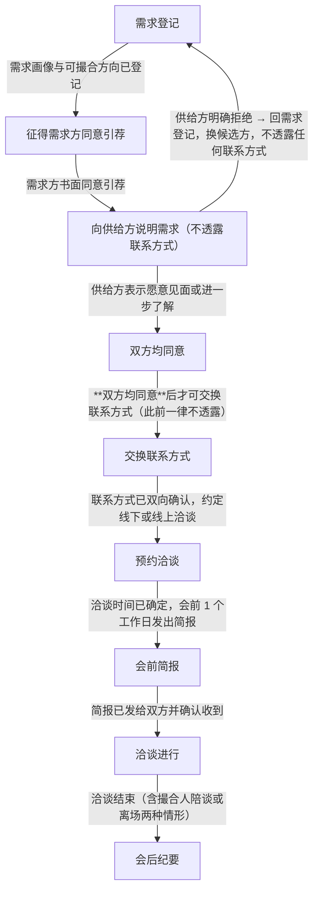

# 引荐对接流程图

> 铁律：双方均同意前不透露联系方式。N4 → N5 是唯一允许交换联系方式的入口。

| 边 | 条件 |
| --- | --- |
| N1 → N2 | 需求画像与可撮合方向已登记 |
| N2 → N3 | 需求方书面同意引荐 |
| N3 → N4 | 供给方表示愿意见面或进一步了解 |
| N3 → N1 | 供给方明确拒绝 → 回需求登记，换候选方，不透露任何联系方式 |
| N4 → N5 | **双方均同意**后才可交换联系方式（此前一律不透露） |
| N5 → N6 | 联系方式已双向确认，约定线下或线上洽谈 |
| N6 → N7 | 洽谈时间已确定，会前 1 个工作日发出简报 |
| N7 → N8 | 简报已发给双方并确认收到 |
| N8 → N9 | 洽谈结束（含撮合人陪谈或离场两种情形） |

## 不透露联系方式的三种落点

1. **S03 向供给方说明需求**：只给需求画像，不给需求方身份与联系方式；
2. **S06 会前简报**：分需求方版/供给方版两版，两版都只写对方「画像」；
3. **流程图结构**：N5（交换联系方式）的唯一入边来自 N4（双方均同意）。

