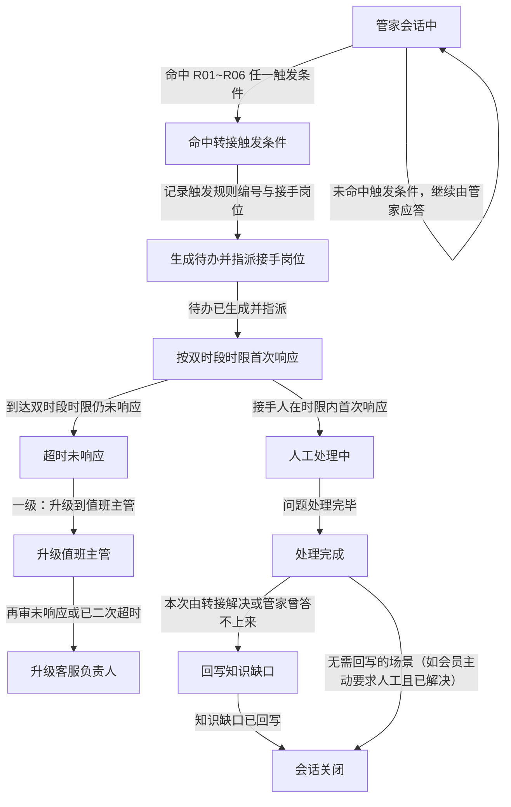

# 客服转人工 SOP：转接规则与响应时限（全部虚构）

> 岗位、时段、时限与条款均为**虚构**，仅用于流程说明与开发对照。
> 转接规则表见 `transfer_rules.csv` 与 `transfer_tables.xlsx`；
> 处理流程图见 `transfer_flow.md`；知识缺口回写字段见 `knowledge_gap.md`。

## 一、双时段响应时限（同一个时长，两种起算点）

| 档位 | 时长 | 工作时间提出（工作日 9:00–18:00） | 非工作时间提出 |
| --- | --- | --- | --- |
| 普通转接 | 30 分钟 | 就地起算（周三 10:00 → **10:30 前**） | 顺延至下一工作日 09:00 起算（周三 19:00 → **周四 09:30 前**） |
| 紧急转接 | 15 分钟 | 就地起算（周三 11:00 → **11:15 前**） | 顺延至下一工作日 09:00 起算（周三 19:00 → **周四 09:15 前**） |

> 「非工作时间」= 工作日 18:00–次日 09:00、周六周日、节假日。
> 实现上只用一个口径：**时长只在工作日 09:00–18:00 内消耗**，非工作时间自动顺延。
> 因此夜间与周末不必各写一条分支，也就不会出现「夜间忘写时限」这类漏洞。
> 紧急档用于：涉及**他人信息**、涉及**合同承诺**——这两类不得按普通档排。

## 二、处理流程图

> 注意 C1 有一个自环（未命中触发条件时继续由管家应答），
> 以及 C9→C11 的旁路（某些场景无需回写知识缺口）。两条边都标注了条件。

## 三、转接规则表

| 规则 | 触发条件 | 接手岗位 | 档位 | 回写缺口 | 备注 |
| --- | --- | --- | --- | --- | --- |
| R01 | 小程序管家答不上来（连续 2 轮未解决或明确表示不确定） | 管家组客服 | normal | 是 | 管家先做一次自查，仍无答案才转；转接时带上会话摘要与已尝试的答案 |
| R02 | 会员主动要求人工 | 客服值班 | normal | 否 | 不得劝阻或二次引导回管家；直接生成待办 |
| R03 | 问题涉及价格谈判（折扣、报价口径、付款方式） | 招商顾问 | normal | 否 | 客服不得给出任何报价口径，只做转接 |
| R04 | 问题涉及合同承诺（条款、免租期、押金、违约） | 招商主管 | urgent | 否 | 合同承诺具法律后果，按紧急档 15 分钟 |
| R05 | 问题涉及他人信息（查询他人会员资料、联系方式、合同） | 数据合规专员 | urgent | 是 | 涉及他人信息一律紧急档，且同时记录一次越权尝试 |
| R06 | 同一会话二次转接或会员明确表达不满 | 值班主管 | normal | 是 | 用于兜住流程内无解的情形 |

共 6 条触发条件，每条都写明接手岗位。

## 四、待办生成与超时升级

| 环节 | 规则 |
| --- | --- |
| 待办生成 | 每次转接生成一条待办，字段含：会话 ID、触发规则编号、接手岗位、起算时刻、响应截止、档位 |
| 一级升级 | 到达响应截止仍未响应 → 升级到**值班主管**，同时通知接手人 |
| 二级升级 | 一级升级后再超时一个档位时长 → 升级到**客服负责人** |
| 关闭条件 | 人工已响应且问题解决；或会员明确放弃 |
| 不计超时 | 接手人已响应但问题未解决（转入处理中，不再算响应超时） |

## 五、处理完成后回写知识缺口（必做）

> 转接不能只解决问题就结束——**管家答不上来的原因必须回写**，否则下次还会转。

| 字段 | 名称 | 要求 |
| --- | --- | --- |
| `gap_id` | 缺口编号 | 自动生成，形如 KG-YYYYMMDD-NN |
| `question` | 会员原问题 | 脱敏后原文，不含会员姓名、手机号与合同金额 |
| `attempted` | 管家已尝试的答案 | 最多 3 条，逐条标注置信度 |
| `fail_reason` | 答不上的原因 | 枚举：知识库缺失 / 条目过时 / 问题歧义 / 超出范围 |
| `suggest` | 建议补充的知识条目 | 一句话，须可被知识库直接采纳 |
| `rule_id` | 触发的转接规则 | R01~R06 |
| `owner` | 回写责任人 | 接手岗位，处理完成后 1 个工作日内提交 |

回写规则：

1. 由**接手岗位**在处理完成后 **1 个工作日内**提交，不转给客服代填；
2. 只有 `backwrite = 是` 的规则必须回写（R01 管家答不上来、R05 他人信息、R06 兜底）；
3. 回写内容一律脱敏：不含会员姓名、手机号、合同金额；
4. 知识库负责人每周汇总一次，形成知识条目补充清单。

## 六、责任矩阵

| 步骤 | 名称 | 管家组客服 | 客服值班 | 招商顾问 | 招商主管 | 数据合规专员 | 值班主管 | 客服负责人 |
| --- | --- | --- | --- | --- | --- | --- | --- | --- |
| R01 | 小程序管家答不上来（连续 2 轮未解 | R |  |  |  |  |  |  |
| R02 | 会员主动要求人工 |  | R |  |  |  |  |  |
| R03 | 问题涉及价格谈判（折扣、报价口径、付 |  |  | R |  |  |  |  |
| R04 | 问题涉及合同承诺（条款、免租期、押金 |  |  |  | R |  |  |  |
| R05 | 问题涉及他人信息（查询他人会员资料、 |  |  |  |  | R |  |  |
| R06 | 同一会话二次转接或会员明确表达不满 |  |  |  |  |  | R |  |

R = 该规则的接手岗位。

## 七、响应时限一览（8 个示例）

| 示例 | 触发规则 | 接手岗位 | 档位 | 提出时刻（时段） | 响应截止 |
| --- | --- | --- | --- | --- | --- |
| P01 | R01 | 管家组客服 | normal | 05-06 10:00（工作时间） | 2026-05-06 10:30 |
| P02 | R02 | 客服值班 | normal | 05-06 14:30（工作时间） | 2026-05-06 15:00 |
| P03 | R04 | 招商主管 | urgent | 05-06 11:00（工作时间） | 2026-05-06 11:15 |
| P04 | R05 | 数据合规专员 | urgent | 05-06 16:50（工作时间） | 2026-05-06 17:05 |
| P05 | R01 | 管家组客服 | normal | 05-06 19:00（非工作时间） | 2026-05-07 09:30 |
| P06 | R03 | 招商顾问 | normal | 05-09 10:00（非工作时间） | 2026-05-11 09:30 |
| P07 | R02 | 客服值班 | normal | 05-08 21:30（非工作时间） | 2026-05-11 09:30 |
| P08 | R01 | 管家组客服 | normal | 05-06 09:20（工作时间） | 2026-05-06 09:50 |

## 八、客服不得越界的三条

- 不得给出任何报价口径（折扣、付款方式）——一律转招商顾问；
- 不得对合同条款做任何承诺——一律转招商主管（紧急档）；
- 不得查询或透露他人会员资料——一律转数据合规专员（紧急档），并记录越权尝试。

## P01（情形：N1、N6）

场景：周三 10:00，会员问的问题管家答不上来 → R01 管家组客服，30 分钟档。

| 项 | 值 |
| --- | --- |
| 命中规则 | R01（小程序管家答不上来（连续 2 轮未解决或明确表示不确定）） |
| 接手岗位 | 管家组客服 |
| 档位 | normal（30 分钟） |
| 提出时刻 | 2026-05-06 10:00 |
| 提出时段 | 工作时间 |
| 响应截止 | 2026-05-06 10:30 |
| 时限口径 | 工作时间转接，30 分钟内首次响应（10:30 前） |
| 回写知识缺口 | 是 |
| 超时升级 | （未触发超时） |

**处理步骤**

1. 管家会话中命中触发条件 → **R01**（小程序管家答不上来（连续 2 轮未解决或明确表示不确定））。
2. 生成待办，指派给 **管家组客服**，起算时刻 10:00。
3. 提出时刻在工作时间内 → 时长就地消耗，响应截止 **10:30**。
4. 回写知识缺口：**必须（处理完成后 1 个工作日内由接手岗位提交）**。

结果：规则 **R01** / 岗位 **管家组客服** / 档位 **normal** / 响应截止 **2026-05-06T10:30** / 回写 **是**

## P02（情形：N1）

场景：周三 14:30，会员主动要求人工 → R02 客服值班，30 分钟档。

| 项 | 值 |
| --- | --- |
| 命中规则 | R02（会员主动要求人工） |
| 接手岗位 | 客服值班 |
| 档位 | normal（30 分钟） |
| 提出时刻 | 2026-05-06 14:30 |
| 提出时段 | 工作时间 |
| 响应截止 | 2026-05-06 15:00 |
| 时限口径 | 工作时间转接，30 分钟内首次响应（15:00 前） |
| 回写知识缺口 | 否 |
| 超时升级 | （未触发超时） |

**处理步骤**

1. 管家会话中命中触发条件 → **R02**（会员主动要求人工）。
2. 生成待办，指派给 **客服值班**，起算时刻 14:30。
3. 提出时刻在工作时间内 → 时长就地消耗，响应截止 **15:00**。
4. 回写知识缺口：**本条规则无需回写**。

结果：规则 **R02** / 岗位 **客服值班** / 档位 **normal** / 响应截止 **2026-05-06T15:00** / 回写 **否**

## P03（情形：N2）

场景：周三 11:00，会员问免租期条款（合同承诺）→ R04 招商主管，15 分钟紧急档。

| 项 | 值 |
| --- | --- |
| 命中规则 | R04（问题涉及合同承诺（条款、免租期、押金、违约）） |
| 接手岗位 | 招商主管 |
| 档位 | urgent（15 分钟） |
| 提出时刻 | 2026-05-06 11:00 |
| 提出时段 | 工作时间 |
| 响应截止 | 2026-05-06 11:15 |
| 时限口径 | 工作时间转接，15 分钟内首次响应（11:15 前） |
| 回写知识缺口 | 否 |
| 超时升级 | （未触发超时） |

**处理步骤**

1. 管家会话中命中触发条件 → **R04**（问题涉及合同承诺（条款、免租期、押金、违约））。
2. 生成待办，指派给 **招商主管**，起算时刻 11:00。
3. 提出时刻在工作时间内 → 时长就地消耗，响应截止 **11:15**。
4. 回写知识缺口：**本条规则无需回写**。

结果：规则 **R04** / 岗位 **招商主管** / 档位 **urgent** / 响应截止 **2026-05-06T11:15** / 回写 **否**

## P04（情形：N2）

场景：周三 16:50，会员要求查他人合同（涉及他人信息）→ R05 数据合规专员，15 分钟紧急档。

| 项 | 值 |
| --- | --- |
| 命中规则 | R05（问题涉及他人信息（查询他人会员资料、联系方式、合同）） |
| 接手岗位 | 数据合规专员 |
| 档位 | urgent（15 分钟） |
| 提出时刻 | 2026-05-06 16:50 |
| 提出时段 | 工作时间 |
| 响应截止 | 2026-05-06 17:05 |
| 时限口径 | 工作时间转接，15 分钟内首次响应（17:05 前） |
| 回写知识缺口 | 是 |
| 超时升级 | （未触发超时） |

**处理步骤**

1. 管家会话中命中触发条件 → **R05**（问题涉及他人信息（查询他人会员资料、联系方式、合同））。
2. 生成待办，指派给 **数据合规专员**，起算时刻 16:50。
3. 提出时刻在工作时间内 → 时长就地消耗，响应截止 **17:05**。
4. 回写知识缺口：**必须（处理完成后 1 个工作日内由接手岗位提交）**。

结果：规则 **R05** / 岗位 **数据合规专员** / 档位 **urgent** / 响应截止 **2026-05-06T17:05** / 回写 **是**

## P05（情形：N3）

场景：周三 19:00 夜间提出，管家答不上来 → 顺延到周四 09:00 起 2 小时内。

| 项 | 值 |
| --- | --- |
| 命中规则 | R01（小程序管家答不上来（连续 2 轮未解决或明确表示不确定）） |
| 接手岗位 | 管家组客服 |
| 档位 | normal（30 分钟） |
| 提出时刻 | 2026-05-06 19:00 |
| 提出时段 | 非工作时间（夜间/周末/节假日） |
| 响应截止 | 2026-05-07 09:30 |
| 时限口径 | 非工作时间转接，顺延至下一工作日 09:00 起 30 分钟内（09:30 前）首次响应 |
| 回写知识缺口 | 是 |
| 超时升级 | （未触发超时） |

**处理步骤**

1. 管家会话中命中触发条件 → **R01**（小程序管家答不上来（连续 2 轮未解决或明确表示不确定））。
2. 生成待办，指派给 **管家组客服**，起算时刻 19:00。
3. 提出时刻在非工作时间 → 顺延到下一工作日 09:00 起算，响应截止 **2026-05-07 09:30**。
4. 回写知识缺口：**必须（处理完成后 1 个工作日内由接手岗位提交）**。

结果：规则 **R01** / 岗位 **管家组客服** / 档位 **normal** / 响应截止 **2026-05-07T09:30** / 回写 **是**

## P06（情形：N4）

场景：周六 10:00 提出，涉及价格谈判 → 顺延到周一 09:00 起 2 小时内。

| 项 | 值 |
| --- | --- |
| 命中规则 | R03（问题涉及价格谈判（折扣、报价口径、付款方式）） |
| 接手岗位 | 招商顾问 |
| 档位 | normal（30 分钟） |
| 提出时刻 | 2026-05-09 10:00 |
| 提出时段 | 非工作时间（夜间/周末/节假日） |
| 响应截止 | 2026-05-11 09:30 |
| 时限口径 | 非工作时间转接，顺延至下一工作日 09:00 起 30 分钟内（09:30 前）首次响应 |
| 回写知识缺口 | 否 |
| 超时升级 | （未触发超时） |

**处理步骤**

1. 管家会话中命中触发条件 → **R03**（问题涉及价格谈判（折扣、报价口径、付款方式））。
2. 生成待办，指派给 **招商顾问**，起算时刻 10:00。
3. 提出时刻在非工作时间 → 顺延到下一工作日 09:00 起算，响应截止 **2026-05-11 09:30**。
4. 回写知识缺口：**本条规则无需回写**。

结果：规则 **R03** / 岗位 **招商顾问** / 档位 **normal** / 响应截止 **2026-05-11T09:30** / 回写 **否**

## P07（情形：N5）

场景：周五 21:30 提出，会员要求人工 → 跨周末顺延到周一 09:00 起 2 小时内。

| 项 | 值 |
| --- | --- |
| 命中规则 | R02（会员主动要求人工） |
| 接手岗位 | 客服值班 |
| 档位 | normal（30 分钟） |
| 提出时刻 | 2026-05-08 21:30 |
| 提出时段 | 非工作时间（夜间/周末/节假日） |
| 响应截止 | 2026-05-11 09:30 |
| 时限口径 | 非工作时间转接，顺延至下一工作日 09:00 起 30 分钟内（09:30 前）首次响应 |
| 回写知识缺口 | 否 |
| 超时升级 | （未触发超时） |

**处理步骤**

1. 管家会话中命中触发条件 → **R02**（会员主动要求人工）。
2. 生成待办，指派给 **客服值班**，起算时刻 21:30。
3. 提出时刻在非工作时间 → 顺延到下一工作日 09:00 起算，响应截止 **2026-05-11 09:30**。
4. 回写知识缺口：**本条规则无需回写**。

结果：规则 **R02** / 岗位 **客服值班** / 档位 **normal** / 响应截止 **2026-05-11T09:30** / 回写 **否**

## P08（情形：N7、N8）

场景：周三 09:20 转接，接手人超时未响应 → 升级值班主管；处理后须回写知识缺口。

| 项 | 值 |
| --- | --- |
| 命中规则 | R01（小程序管家答不上来（连续 2 轮未解决或明确表示不确定）） |
| 接手岗位 | 管家组客服 |
| 档位 | normal（30 分钟） |
| 提出时刻 | 2026-05-06 09:20 |
| 提出时段 | 工作时间 |
| 响应截止 | 2026-05-06 09:50 |
| 时限口径 | 工作时间转接，30 分钟内首次响应（09:50 前） |
| 回写知识缺口 | 是 |
| 超时升级 | 值班主管 |

**处理步骤**

1. 管家会话中命中触发条件 → **R01**（小程序管家答不上来（连续 2 轮未解决或明确表示不确定））。
2. 生成待办，指派给 **管家组客服**，起算时刻 09:20。
3. 提出时刻在工作时间内 → 时长就地消耗，响应截止 **09:50**。
4. 到达截止仍未响应 → 一级升级到**值班主管**；再审未响应则升客服负责人。
5. 回写知识缺口：**必须（处理完成后 1 个工作日内由接手岗位提交）**。

结果：规则 **R01** / 岗位 **管家组客服** / 档位 **normal** / 响应截止 **2026-05-06T09:50** / 回写 **是**

## 8 类情形覆盖对照表

| 编号 | 情形 | 示例 |
| --- | --- | --- |
| N1 | 工作时间转接（30 分钟档） | P01、P02 |
| N2 | 工作时间·紧急转接（15 分钟档） | P03、P04 |
| N3 | 非工作时间转接：夜间 18:00 后 | P05 |
| N4 | 非工作时间转接：周末 | P06 |
| N5 | 非工作时间顺延跨周末（周五夜） | P07 |
| N6 | 待办生成与接手岗位指派 | P01 |
| N7 | 超时升级（一级到值班主管） | P08 |
| N8 | 处理完成后回写知识缺口 | P08 |
