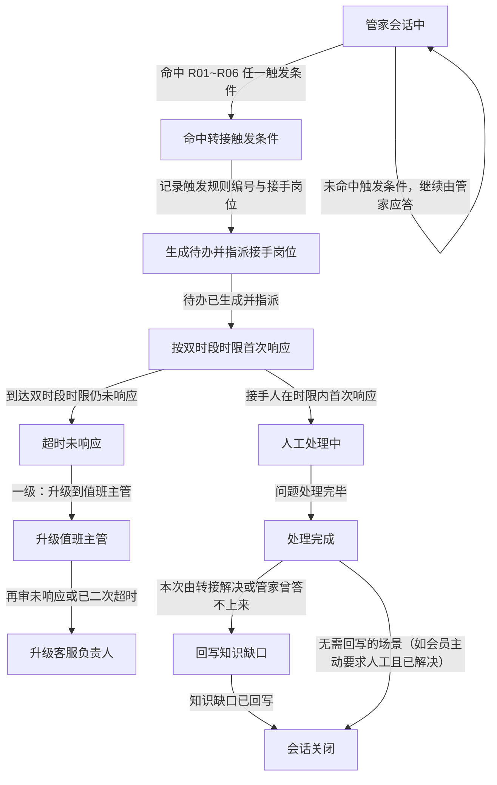

# 客服转人工处理流程图

> 每条边都标注触发条件；C1 有自环（未命中则继续由管家应答），C9→C11 是无需回写的旁路。

| 边 | 条件 |
| --- | --- |
| C1 → C2 | 命中 R01~R06 任一触发条件 |
| C1 → C1 | 未命中触发条件，继续由管家应答 |
| C2 → C3 | 记录触发规则编号与接手岗位 |
| C3 → C4 | 待办已生成并指派 |
| C4 → C5 | 接手人在时限内首次响应 |
| C4 → C6 | 到达双时段时限仍未响应 |
| C6 → C7 | 一级：升级到值班主管 |
| C7 → C8 | 再审未响应或已二次超时 |
| C5 → C9 | 问题处理完毕 |
| C9 → C10 | 本次由转接解决或管家曾答不上来 |
| C10 → C11 | 知识缺口已回写 |
| C9 → C11 | 无需回写的场景（如会员主动要求人工且已解决） |

## 两条升级路径

1. **一级**：C6（超时未响应）→ C7（值班主管）；
2. **二级**：C7 再审仍未响应或已二次超时 → C8（客服负责人）。

> 结构上 C7 的唯一入边是 C6、C8 的唯一入边是 C7 —— 不存在「未超时就直接升级」或「跳过一级」的路径。

